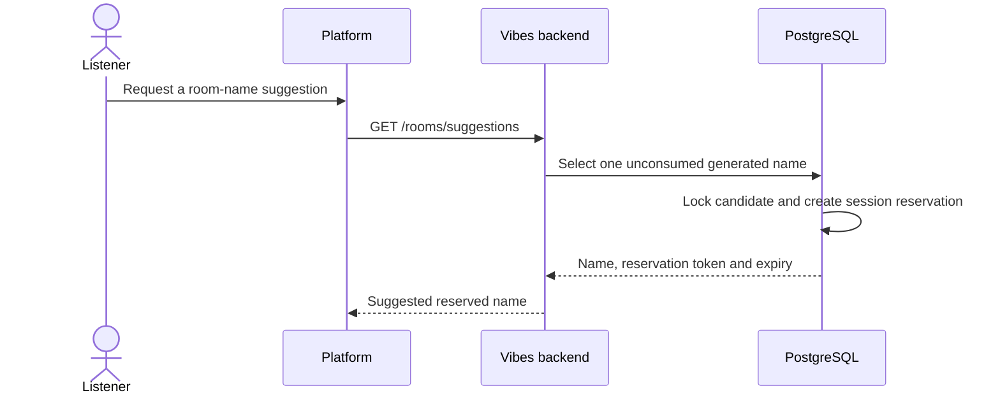
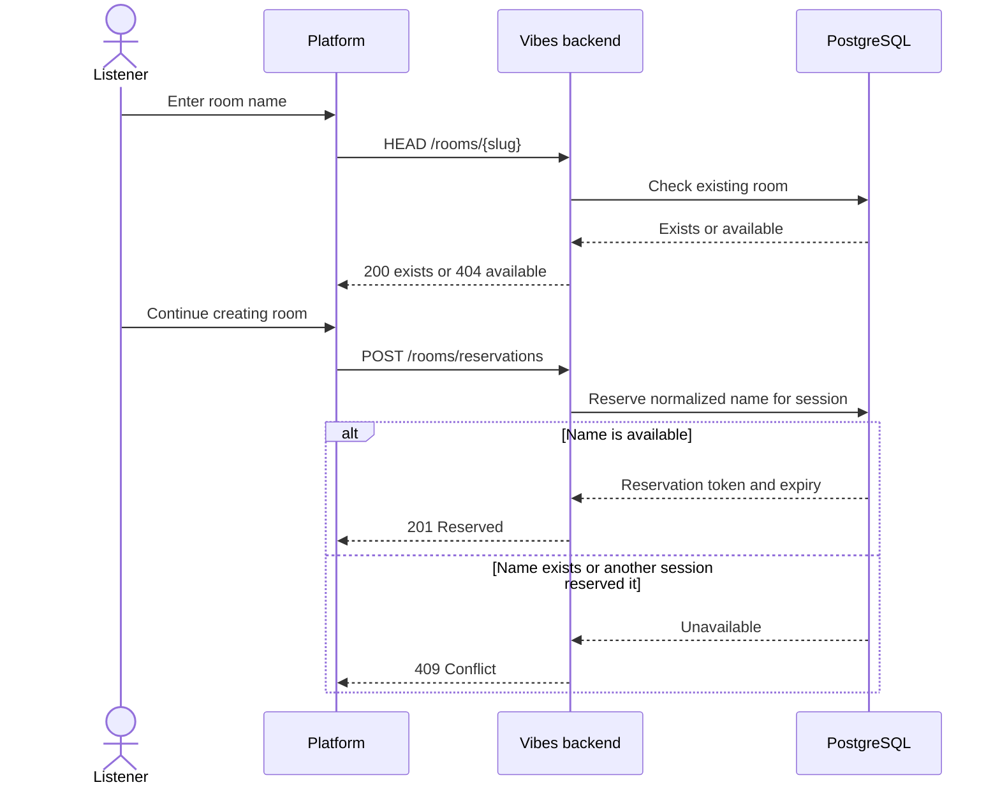
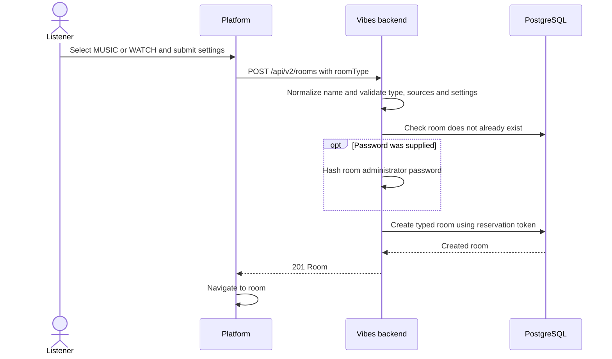
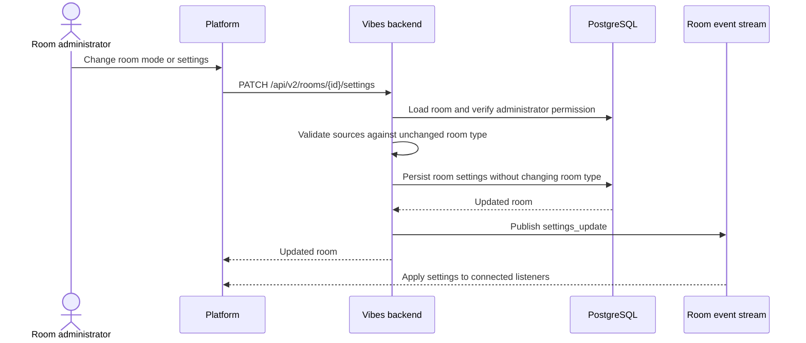

# Room Names, Creation, and Settings

## Room IDs and display names

Room IDs are persisted URL identifiers, separate from the display name. Apply
name-to-ID conversion only when reserving or creating a new room. Existing room
lookups, links, playback, sessions and events must keep using the stored ID;
never recompute it from the display name or migrate it when naming rules change.
For example, an existing room named `dümen-8` keeps its stored ID `dmen-8` and
URL `/dmen-8`.

For new rooms, ASCII names retain the existing slug rules. Names containing
non-ASCII characters are encoded as hyphen-separated Unicode code points, such
as `東京` → `u6771-u4eac`, while the original name remains the display name.
Reservations and creation use the same conversion. This requires no database
migration or changes to existing rooms, queues, sessions, or reservations.

## Enter an existing room

`GET /api/v2/room-resolutions?name=...` resolves typed input to an existing
room without renaming it. An exact stored ID wins, followed by an exact display
name, the current encoded ID, and finally the legacy ASCII slug. If multiple
rooms have the same display name, the oldest is chosen with ID as the tie-breaker;
an exact ID can always be used to select a specific room. For example, typing
`dümen-8` resolves to the existing `dmen-8` room. SQL parameters handle input as
data, and the ordinary room fetch determines the requesting user's permissions.

Clients use the resolved ID for navigation, sessions, playback, queues, and
subsequent events. Only a 404 offers creation; other failures remain errors.
The resolver is a separate endpoint so it does not shadow any existing room ID.

## Generate and reserve a room name

Room name suggestions come from the generated name pool and are reserved for the
current signed session before the frontend presents them.



## Check and reserve room name availability

A lightweight HEAD request checks whether a room already exists. The reservation
endpoint provides the authoritative availability check used before creation.



## Create a room

The selected experience becomes the immutable `roomType`. It defaults to MUSIC
when omitted; WATCH only permits YouTube. Playback `mode` remains a separate
choice. Legacy v1 creation continues to create MUSIC rooms.



## Update room settings



## Browse rooms and load community totals

```mermaid
sequenceDiagram
    actor Participant
    participant Platform
    participant API as Vibes backend
    participant DB as PostgreSQL
    participant Cache as Redis

    Participant->>Platform: Select MUSIC or WATCH
    Platform->>API: GET /api/v3/rooms/public?roomType=MUSIC or WATCH
    API->>DB: Filter public rooms by type and requested live state
    DB-->>API: Matching rooms and pagination totals
    API-->>Platform: Typed room results
    Platform->>API: GET /api/v2/stats?roomType=MUSIC or WATCH
    API->>Cache: Read type-specific statistics
    opt Cache miss
        API->>DB: Count rooms, playlist items and participants for type
        DB-->>API: Type-specific totals
        API->>Cache: Store type-specific statistics
    end
    API-->>Platform: Counts for selected experience only
```
